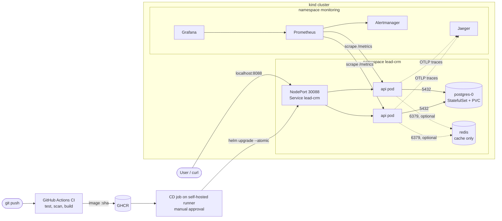

# Running and operating the Lead CRM on Kubernetes

This document covers the DevOps setup added on top of the original project:
how to run it, how a change gets deployed, how to check it is healthy and what
the known limitations are. Design reasoning is in [decisions.md](decisions.md)
and alert handling is in [runbook.md](runbook.md).

## Architecture



**Request path:** client → `localhost:8088` → kind port mapping → NodePort
Service → one of the two ready api pods → Redis (for `GET /leads/:id`) →
PostgreSQL on a cache miss or for any write.

**Failure boundaries:**

| Component down | What happens | Why |
|---|---|---|
| One api pod | Other pod keeps serving, k8s replaces it | 2 replicas, readiness removes it from the Service |
| Redis | API keeps working, reads go to Postgres (~ms slower) | Redis is a cache; short timeouts and errors are treated as misses |
| PostgreSQL | `/readyz` fails, pods leave the Service, `LeadCrmPostgresDown` fires | Every request needs the db, so pods should not get traffic |
| Jaeger | Nothing user facing, spans are dropped | Tracing failures never stop the app |
| Prometheus/Grafana | No metrics or alerts, API unaffected | Monitoring is out of the request path |

## Prerequisites

- Docker (Docker Desktop is fine, give it at least 6 GB RAM)
- [kind](https://kind.sigs.k8s.io/) 0.24+ (needs its built-in NetworkPolicy support)
- kubectl, Helm 3.14+ (tested with Helm 4)
- make, openssl, curl
- Go 1.26+ only if you want to run the tests locally

Ports used on the host: `8088` (API). Grafana, Prometheus and Jaeger are
reached with `kubectl port-forward`.

## Quick start (everything local)

```bash
git clone https://github.com/BHAV0207/SuperLeap-BackendAssignment.git
cd SuperLeap-BackendAssignment

make up
```

`make up` runs these steps, each can also be run on its own:

| Step | What it does |
|---|---|
| `make cluster` | Creates the `lead-crm` kind cluster from `deploy/kind-config.yaml` |
| `make secrets` | Creates namespace `lead-crm` and secret `lead-crm-db` with a random password |
| `make monitoring` | Installs kube-prometheus-stack (Prometheus, Grafana, Alertmanager) and Jaeger in `monitoring` |
| `make image` | Builds the image tagged with the current commit sha and loads it into kind |
| `make deploy` | `helm upgrade --install --atomic` of `deploy/helm/lead-crm` with that tag |
| `make smoke` | Checks `/readyz`, checks `/version` matches the tag, creates/reads/updates/deletes a lead |

First run takes around 5 minutes, mostly image pulls.

To deploy the exact image CI built instead of building locally, see
[Deploying through the pipeline](#deploying-through-the-pipeline).

Tear down with `make down`.

## Accessing things

| What | How |
|---|---|
| API | `http://localhost:8088` e.g. `curl localhost:8088/leads` |
| Running version | `curl localhost:8088/version` |
| Readiness / liveness | `curl localhost:8088/readyz`, `curl localhost:8088/healthz` |
| Grafana | `kubectl -n monitoring port-forward svc/kube-prometheus-stack-grafana 3000:80` then http://localhost:3000, dashboard **Lead CRM** |
| Grafana login | user `admin`, password: `kubectl -n monitoring get secret grafana-admin -o jsonpath='{.data.admin-password}' \| base64 -d` |
| Prometheus | `kubectl -n monitoring port-forward svc/kube-prometheus-stack-prometheus 9090` then http://localhost:9090/alerts |
| Alertmanager | `kubectl -n monitoring port-forward svc/kube-prometheus-stack-alertmanager 9093` |
| Jaeger | `kubectl -n monitoring port-forward svc/jaeger 16686` then http://localhost:16686, service `lead-crm` |
| Logs | `kubectl -n lead-crm logs -l app.kubernetes.io/name=lead-crm --prefix` (JSON, one line per request) |

API endpoints are listed in the main [README](../README.md#api-endpoints).

## What is deployed

`deploy/helm/lead-crm` is the only place the Kubernetes config lives.
Environment differences go in `values.yaml` overrides (`-f` / `--set`), not in
copied manifests.

| Object | Purpose |
|---|---|
| Deployment `lead-crm` | 2 api replicas, rolling update with `maxUnavailable: 0`, startup/liveness/readiness probes, requests/limits, non-root read-only container |
| Service `lead-crm` | NodePort 30088, mapped to `localhost:8088` by kind |
| ConfigMap `lead-crm-config` | All non-secret settings (db host, redis host, log level, OTLP endpoint) |
| Secret `lead-crm-db` | DB password, created by `make secrets`, never in git |
| ServiceAccount `lead-crm` | No roles, token not mounted |
| PodDisruptionBudget | At least 1 api pod during drains |
| StatefulSet `postgres` + PVC | Data survives pod restarts (1Gi, kind's local-path storage) |
| Deployment `redis` | Cache only, no persistence, LRU at 64MB |
| NetworkPolicies | Default deny ingress; postgres and redis only accept the api pods |
| ServiceMonitor, PrometheusRule | Scrape config, SLI recording rules and alerts |
| ConfigMap `lead-crm-dashboard` | Grafana dashboard, loaded by the Grafana sidecar |

## CI/CD

### CI (`.github/workflows/ci.yml`)

Runs on every pull request and push to `main`.

1. **Lint and test**: gofmt, `go vet`, `go test -race`, `govulncheck`
2. **Helm chart lint**: `helm lint` and `helm template`
3. **Secret scan**: gitleaks over the full git history
4. **Build, scan and push** (only if 1-3 pass): builds the image with the
   commit sha baked in, scans it with Trivy (fails on fixable HIGH/CRITICAL),
   then pushes `ghcr.io/bhav0207/lead-crm:<7 char sha>`

The image tag is always the commit sha. On pull requests the workflow uses
the PR head commit, not GitHub's temporary merge commit, so the tag always
points to a commit you can find in the branch.

### CD (`.github/workflows/cd.yml`)

The cluster is local, so GitHub's hosted runners cannot reach it. The deploy
job runs on a self-hosted runner on the same machine (label `lead-crm-kind`)
and is gated by the `local-kind` GitHub environment, which needs manual
approval.

Trigger: automatically after CI succeeds on `main`, or manually with
**Run workflow** and an image tag (this is how a PR build is deployed before
merge).

Steps: pull the CI image from GHCR → `kind load` → `make deploy TAG=<sha>`
(`helm upgrade --atomic`) → `make smoke TAG=<sha>` → write helm history and
`/version` to the job summary.

### Deploying through the pipeline

One-time runner setup (on the machine that runs kind):

1. Repo **Settings → Actions → Runners → New self-hosted runner**, follow the
   macOS/Linux steps and add the label `lead-crm-kind` when asked.
2. Repo **Settings → Environments → New environment** `local-kind`, add
   yourself as a required reviewer.
3. Start the runner with `./run.sh`. It needs `docker`, `kind`, `kubectl`,
   `helm` and `make` on its PATH and the `lead-crm` cluster from `make up`.

Then: push → CI goes green → CD waits for approval → approve → deploy and smoke
test run → the summary shows the deployed tag and `/version`.

### Tracing a commit to the running pods

```bash
git rev-parse --short HEAD                     # e.g. 1a2b3c4
# CI run for that commit pushes ghcr.io/bhav0207/lead-crm:1a2b3c4
helm -n lead-crm get values lead-crm | grep tag     # tag: 1a2b3c4
kubectl -n lead-crm get pods -L app.kubernetes.io/version
curl -s localhost:8088/version                  # {"version":"1a2b3c4","commit":"1a2b3c4...full sha"}
```

The same version shows in every log line (`version`, `commit` fields) and in
the `app_build_info` metric (top left panel on the dashboard).

## Release and rollback

- **Strategy:** rolling update, one extra pod at a time, an old pod is only
  removed after the new one passes readiness. Clients see no errors.
- **Automatic rollback:** `helm upgrade --atomic --timeout 3m` reverts to the
  previous revision if the new pods do not become ready.
- **Manual rollback:** `make rollback` (previous revision) or
  `make rollback REVISION=<n>`; `helm -n lead-crm history lead-crm` lists
  revisions with their image tag.
- **Drift:** the app is only changed through the chart and a commit tag, never
  with `kubectl edit`. `helm get values lead-crm` shows exactly what is
  deployed, and any manual change is overwritten by the next deploy. Only the
  namespace, secrets and monitoring add-ons are applied outside the chart.

## Observability

- **Metrics** (`/metrics`): `http_requests_total{method,route,status}`,
  `http_request_duration_seconds` histogram, `http_requests_in_flight`,
  `lead_cache_requests_total{result=hit|miss|error}`, `leads_created_total`,
  `dependency_up{dependency}`, `app_build_info{version,commit}`.
- **Logs:** JSON on stdout, one line per request with `request_id`,
  `trace_id`, `route`, `status`, `duration_ms`, plus `version`/`commit`.
  Probe requests are not logged unless they fail.
- **Traces:** OpenTelemetry, one span per request with child spans for each
  SQL query and Redis call, exported to Jaeger. A `trace_id` in a log line
  can be pasted into Jaeger to see where the time went.
- **SLOs:** 99.5% of user requests are not 5xx, 95% finish under 300ms.
  Alerts and what to do about them are in [runbook.md](runbook.md).

## Security

- DB and Grafana passwords are generated at install time and stored only in
  Kubernetes Secrets. `.env` is git-ignored; `.env.example` has placeholders.
- Containers run as non-root with a read-only root filesystem, all
  capabilities dropped, no privilege escalation and the RuntimeDefault seccomp
  profile. The api image is distroless (no shell, no package manager).
- The api ServiceAccount has no RBAC roles and no mounted token.
- NetworkPolicies: default deny ingress, Postgres and Redis only reachable
  from api pods.
- Only the api is exposed outside the cluster, and only on `127.0.0.1`.
- CI: gitleaks, govulncheck, Trivy image scan, actions pinned to commit shas,
  workflow token is read-only except where the image is pushed. Dependabot
  keeps Go modules, actions and base images updated.
- CD runs on a self-hosted runner only for `main` / manual dispatch and needs
  approval, so pull requests from forks never execute on that machine.

## Running without Kubernetes

The original flow still works:

```bash
cp .env.example .env
docker compose up -d          # postgres + redis
go run ./cmd/server
```

## Known limitations

- Single node kind cluster: the two api replicas share one node, so this does
  not protect against node failure. `topologySpreadConstraints` would be
  added on a multi node cluster.
- PostgreSQL is a single instance with no backups or replication. Fine for a
  local project, a managed database or an operator (e.g. CloudNativePG) would
  be used for real data.
- No TLS: traffic is plain HTTP on localhost. An Ingress or Gateway with
  cert-manager would handle this on a real cluster.
- The API has no authentication (it did not have any in the original project).
- Jaeger uses in-memory storage, traces are lost when its pod restarts.
- Logs are read with `kubectl logs`; there is no central log store (Loki)
  because one namespace on one node did not need it.
- No HPA: load is tiny and kind has no metrics-server by default. Replicas
  are fixed at 2 for availability, not throughput.
- CD depends on the self-hosted runner being online on the machine with the
  cluster.
- Alertmanager has no receiver configured, alerts are visible in the
  Prometheus/Alertmanager UI only.
